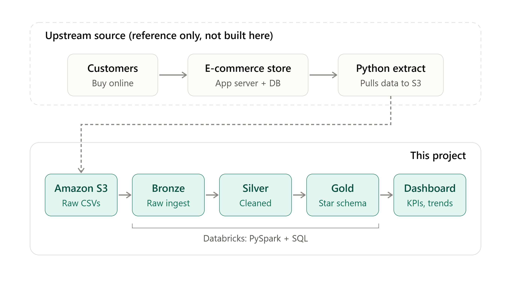

# Retail E-Commerce Data Engineering & Analytics Platform

An end-to-end retail analytics workflow built with **Amazon S3, Databricks, PySpark, Unity Catalog, and a business dashboard**. The project organizes retail source data through a Bronze–Silver–Gold Medallion Architecture and uses the curated data to derive business insights and recommendations.

## Project Overview

Retail transaction data can be difficult to analyze when raw files, inconsistent fields, and business dimensions are handled separately. This project builds a structured data workflow that takes retail source datasets through ingestion, transformation, modeling, and analysis.

The workflow covers:
- Source datasets for customers, products, brands, categories, dates, and order items.
- Fact and dimension processing using separate Databricks notebooks.
- Bronze, Silver, and Gold data layers.
- A final Gold-layer transaction dataset with approximately **183K order-item records**.
- A dashboard for exploring sales and retail performance.
- Business analysis covering category concentration, customer repeat behavior, discounts, channels, international markets, and sales timing.

## Project Goals

- Build a repeatable retail data processing workflow.
- Structure raw and transformed data using Medallion Architecture.
- Organize datasets and schemas through Unity Catalog.
- Prepare curated fact and dimension tables for analytics.
- Convert the Gold-layer data into business insights and actionable recommendations.
- Present key performance patterns through a dashboard.

## Tech Stack

| Component | Technology | Purpose |
|---|---|---|
| Cloud object storage | Amazon S3 | Stores retail source datasets |
| Data processing | Databricks + PySpark | Ingests, cleans, transforms, and aggregates data |
| Data organization and governance | Unity Catalog | Organizes catalogs, schemas, and tables |
| Data architecture | Medallion Architecture | Structures Bronze, Silver, and Gold layers |
| Data visualization | Retail performance dashboard | Presents analytical KPIs and business trends |
| Source data format | CSV | Provides structured retail datasets |

## End-to-End Workflow



```text
Retail Source CSVs
(customers, products, brands, categories, dates, order items)
                  |
                  v
            Amazon S3
          Source data storage
                  |
                  v
         Databricks + PySpark
                  |
                  v
        Bronze Layer — Ingestion
          Raw fact and dimensions
                  |
                  v
      Silver Layer — Transformation
        Cleaning and standardization
                  |
                  v
         Gold Layer — Data Modeling
       Curated fact and dimension tables
                  |
                  v
        Business Analysis & KPIs
                  |
                  v
           Retail Dashboard
                  |
                  v
       Insights and Recommendations
```


## Data Sources

The project uses retail e-commerce datasets covering:

- **Customers:** Customer reference data.
- **Products:** Product attributes, SKU and product details.
- **Brands:** Brand reference information.
- **Categories:** Product category mapping.
- **Dates:** Calendar attributes for time-based analysis.
- **Order items:** Daily retail transaction records across the observed period.

The Gold fact dataset contains approximately **183,000 order-item rows** and includes fields for transaction dates and timestamps, transaction and customer IDs, product and SKU details, channel, coupon information, unit price, quantity, gross amount, discounts, tax, net amounts, currency conversion to INR, category, brand, color, size, and time attributes.

## Data Engineering Pipeline

### 1. Catalog and Schema Setup

- Configure the catalog and schemas used by the pipeline through `setup_catalog.ipynb`.
- Organize tables and data assets for the subsequent processing stages.

### 2. Bronze Layer — Raw Ingestion

- Load raw fact and dimension source data using PySpark.
- Keep fact and dimension ingestion logic in separate notebooks.
- Establish the initial data layer for downstream transformations.

**Notebooks:**
- `1_dim_bronze.ipynb`
- `1_fact_bronze.ipynb`

### 3. Silver Layer — Cleaning and Transformation

- Apply cleaning and transformation logic to the source datasets.
- Standardize data for consistent downstream use.
- Prepare fact and dimension datasets for analytical modeling.

**Notebooks:**
- `2_dim_silver.ipynb`
- `2_fact_silver.ipynb`

### 4. Gold Layer — Curated Data Modeling

- Create curated fact and dimension datasets.
- Combine transaction-level measures with relevant product, category, brand, customer, and calendar attributes.
- Prepare the data for business queries, KPI calculation, and visualization.

**Notebooks:**
- `3_dim_gold.ipynb`
- `3_fact_gold.ipynb`

### 5. Business Analysis and Dashboard

- Analyze sales and transaction patterns from the Gold layer.
- Compare performance by category, brand, channel, time, customer repeat behavior, coupon usage, and currency/market.
- Present selected KPIs and trends through a retail dashboard.
- Translate analytical findings into recommendations for merchandising, retention, discounting, channel optimization, and market performance.

## Business Insights Identified

The analysis of the Gold-layer transaction dataset highlighted several areas for further business action.

### Revenue and Category Concentration

Electronics represented approximately **75.8% of recorded INR sales** in the analyzed dataset. This concentration makes availability, delivery reliability, and margin monitoring important for high-value products.

**Recommendation:** Review high-revenue SKUs for contribution margin, stock-outs, supplier lead times, and returns before prioritizing additional inventory or promotions.

### Customer Repeat Behavior

Approximately **16.3% of observed customers** placed more than one transaction in the analysis window, with a median gap of about 25 days between repeat transactions.

**Recommendation:** Test category-relevant post-purchase journeys and second-order incentives, measuring incremental repeat purchases against a holdout group.

### Coupon and Discount Evaluation

Coupon and non-coupon orders showed similar average basket measures in the observed data. This alone does not establish whether coupons are incremental.

**Recommendation:** Run controlled coupon holdout tests and assess incremental revenue and contribution margin before changing discount policy.

### Channel and International Market Performance

Recorded sales differed by channel and currency/market, suggesting a need to compare customer mix, product mix, pricing, delivery, payment options, and marketing execution.

**Recommendation:** Investigate channel conversion and market-specific performance before reallocating marketing spend.

### Sales Timing

Average weekend sales were higher than weekday sales in the analyzed period.

**Recommendation:** Test weekend-focused promotions and operational planning, and evaluate results using orders, conversion, and contribution margin rather than revenue alone.

> These are descriptive findings from the available dataset. Profitability, campaign ROI, and causal impact cannot be established without cost, marketing, inventory, returns, and experimental data.

## How to Run the Project

1. Import the notebooks into your Databricks workspace.
2. Configure the required catalog and schemas using `setup_catalog.ipynb`.
3. Ensure the source files are available at the paths referenced by the Bronze notebooks.
4. Run the Bronze notebooks to ingest fact and dimension data.
5. Run the Silver notebooks to clean and transform the datasets.
6. Run the Gold notebooks to create curated fact and dimension tables.
7. Validate row counts, data quality, financial calculations, and currency conversion.
8. Connect the Gold datasets to the dashboard and validate the displayed KPIs against notebook calculations.

## Key Outcomes

- Developed a multi-stage retail data workflow using Databricks and PySpark.
- Structured fact and dimension processing across Bronze, Silver, and Gold layers.
- Prepared a curated transaction dataset of approximately 183K order-item records.
- Analyzed retail performance across categories, customers, discounts, channels, markets, and time.
- Built a dashboard to present key retail performance measures and trends.
- Formulated evidence-based recommendations for retention, merchandising, promotions, and market execution.

GitHub: [TusharSaini300](https://github.com/TusharSaini300)
